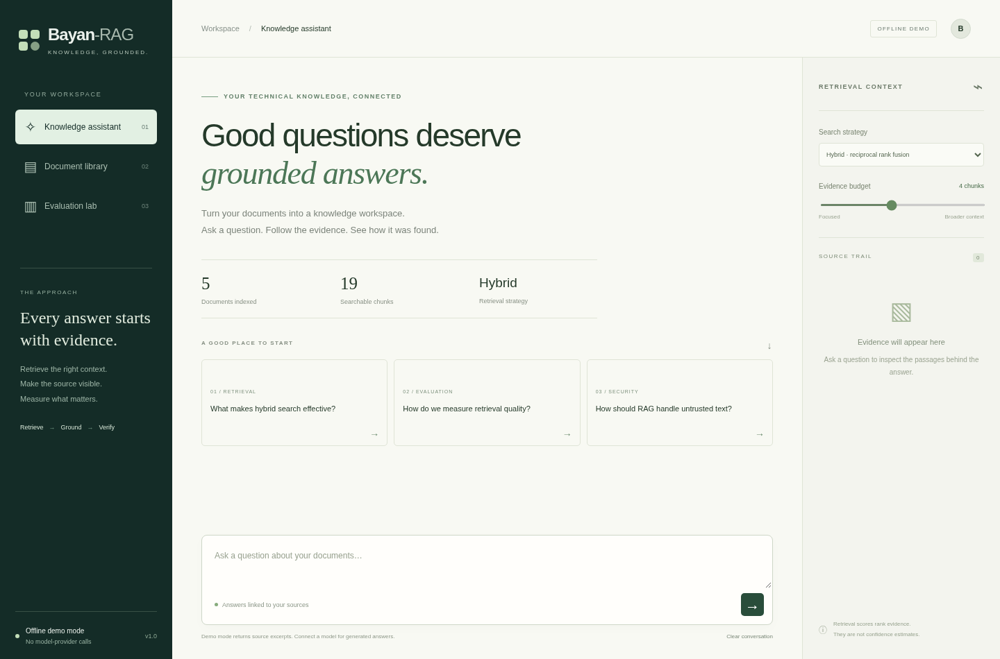
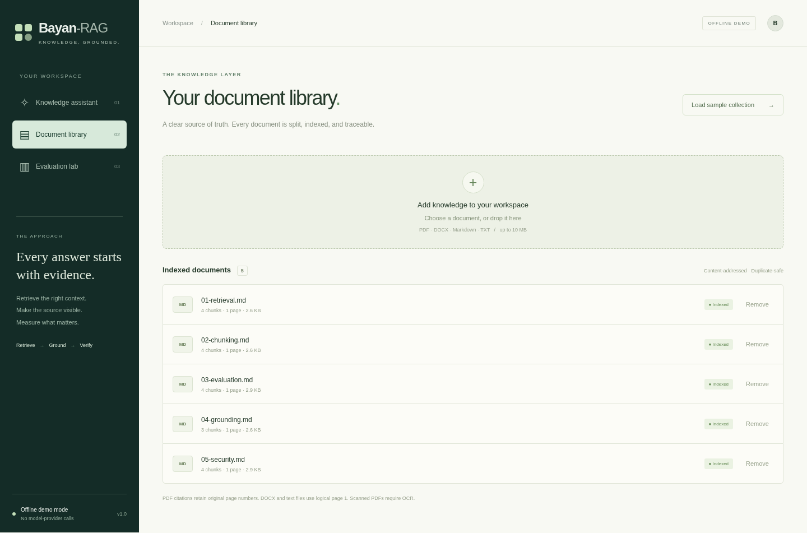
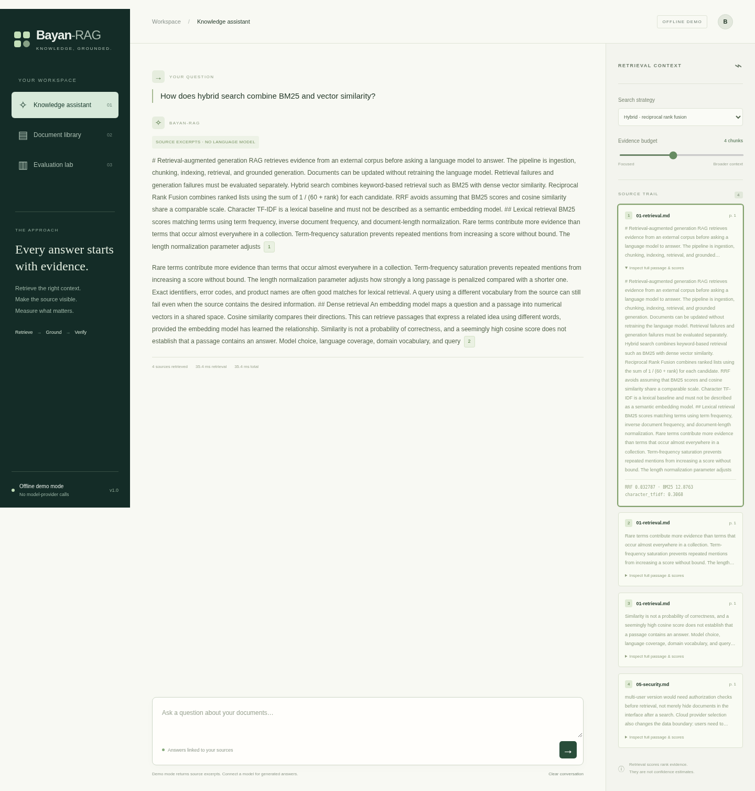
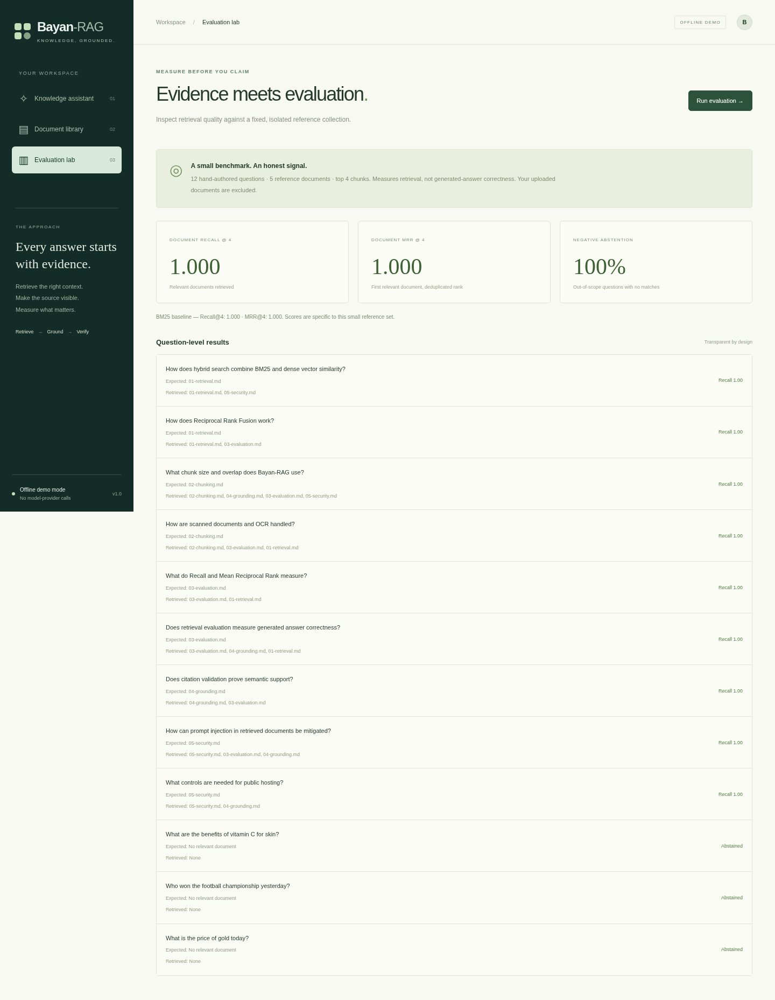
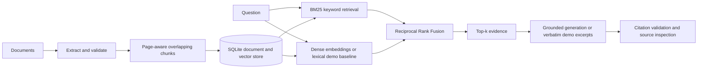

# Bayan-RAG

### Knowledge, grounded.

An evidence-first workspace that turns technical documents into searchable knowledge, traceable answers, and measurable retrieval results.

[Architecture](docs/ARCHITECTURE.md) · [Evaluation](docs/EVALUATION.md) · [API reference](docs/API.md) · [Technical setup](docs/SETUP.md)

## The problem

Technical knowledge is often spread across papers, internal guides, and long reference documents. Keyword search can find a term without finding the right context. A language model can produce a convincing answer without showing where it came from. Neither behavior is enough when an answer needs to be checked.

Bayan-RAG makes the evidence visible throughout the process: which passages were retrieved, how they were ranked, which document they belong to, and which sources each generated claim references.

## The workspace

An additional **Gradio demo** provides a session-local document collection and offline evidence retrieval for Hugging Face Spaces. It requires no model-provider credentials. Hosting availability follows the platform's current account eligibility rules. See the [Spaces deployment guide](docs/HUGGINGFACE.md).

**Knowledge assistant.** Ask questions against an indexed collection. Follow numbered citations to the underlying passages, inspect retrieval scores, and adjust the search strategy or evidence budget. Questions without matching evidence return an explicit abstention.

**Document library.** Add PDF, DOCX, Markdown, or text documents. Page-aware chunking preserves PDF source locations, content hashing prevents duplicate indexing, and document removal also removes its indexed chunks.

**Evaluation lab.** Compare hybrid retrieval with a BM25 baseline using an isolated reference collection. Inspect document-level Recall@4, MRR@4, negative-query abstention, and the expected and retrieved documents for each question.

Explore the interface

**Document library**

**Evidence inspection**

**Evaluation lab**

## How it works

The connected pipeline combines BM25 with embedding cosine similarity through Reciprocal Rank Fusion. The offline demo combines BM25 with character TF-IDF and returns verbatim source excerpts. The interface labels these modes explicitly; character TF-IDF is a lexical baseline, not a semantic embedding model.

| Capability | Engineering approach |
| --- | --- |
| Traceable evidence | Document identity, chunk identity, source text, and original PDF page |
| Hybrid ranking | BM25 and a secondary ranking fused with `1 / (60 + rank)` |
| Grounded output | Structured claims with required citations; invalid citation IDs are rejected |
| Provider choice | Offline demo, OpenAI, or local Ollama adapters |
| Reliable ingestion | SHA-256 deduplication and atomic document/chunk persistence |
| Inspectable retrieval | Raw BM25, secondary similarity, RRF score, and retrieval latency |
| Reproducible checks | Hash-pinned runtime dependencies, automated tests, and CI |

## Evaluation snapshot

The committed [evaluation report](docs/evaluation-results.json) uses **12 hand-authored questions**, **5 reference documents**, and an evidence budget of **4 chunks**. Nine questions have an expected document; three are out of scope.

| Offline retrieval strategy | Document Recall@4 | Document MRR@4 | Negative-query abstention |
| --- | ---: | ---: | ---: |
| BM25 baseline | 1.000 | 1.000 | 1.000 |
| BM25 + character TF-IDF / RRF | 1.000 | 1.000 | 1.000 |

Both strategies tie on this small, lexically aligned collection. These results establish a regression baseline; they do **not** demonstrate a hybrid-search advantage, production accuracy, or generated-answer correctness. Dense retrieval and live model generation are not represented in these offline scores. See the [evaluation methodology](docs/EVALUATION.md) for metric definitions and limitations.

## Design decisions

- **A small, explicit retrieval core.** Ranking, persistence, and provider calls are separate modules, making the pipeline inspectable without an orchestration framework.
- **SQLite for a bounded reference application.** A single database keeps documents and embeddings easy to inspect. Retrieval currently scans the collection; a vector index is the next step for larger corpora.
- **Evidence over confidence labels.** Retrieval scores are displayed as ranking signals, never as probabilities that an answer is correct.
- **Failures stay visible.** Provider outages, embedding configuration changes, unsupported files, and invalid model responses return explicit errors.
- **Evaluation stays separate from user data.** Each evaluation builds a temporary reference index, preventing uploaded documents from changing benchmark results.

## Scope and boundaries

Bayan-RAG is a single-user engineering reference project with an English interface. It is suitable for exploring and explaining a complete retrieval pipeline, rather than operating as a public multi-tenant service. Public application hosting requires authentication, authorization, rate limits, and additional file-processing isolation.

Citation validation confirms that a source exists in the retrieved context; it does not prove semantic support for a claim. Prompt separation and structured output reduce risk but do not eliminate prompt injection. Scanned PDFs require OCR before ingestion, and DOCX/text documents use logical page 1.

## Next directions

- Expand the evaluation set with independently judged, held-out questions and realistic negative examples.
- Compare chunk sizes and dense embedding models under the same evaluation protocol.
- Add answer-level faithfulness and citation-support assessment.
- Introduce a persistent vector index and reranking after measuring a retrieval bottleneck.

## License

[MIT](LICENSE)
